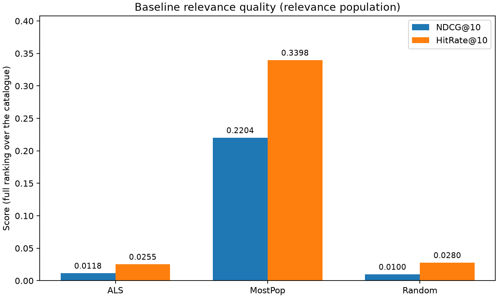
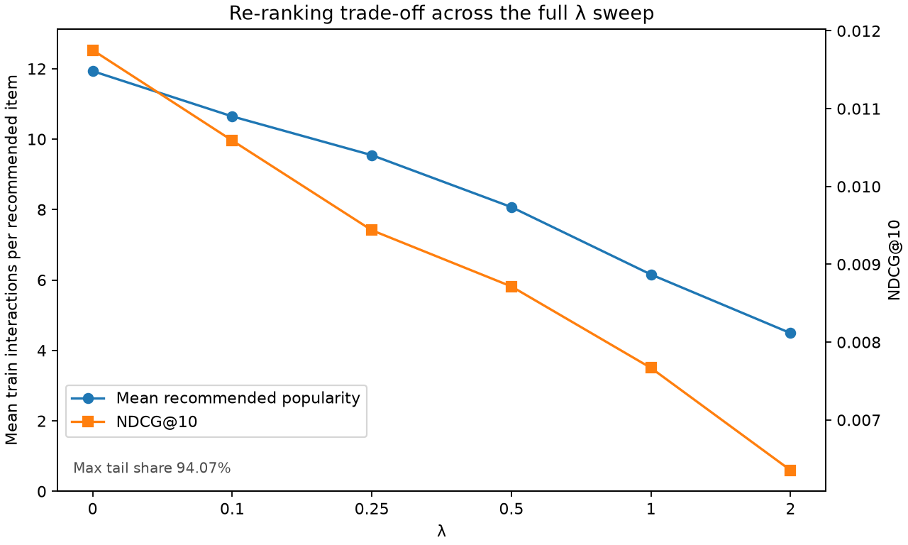
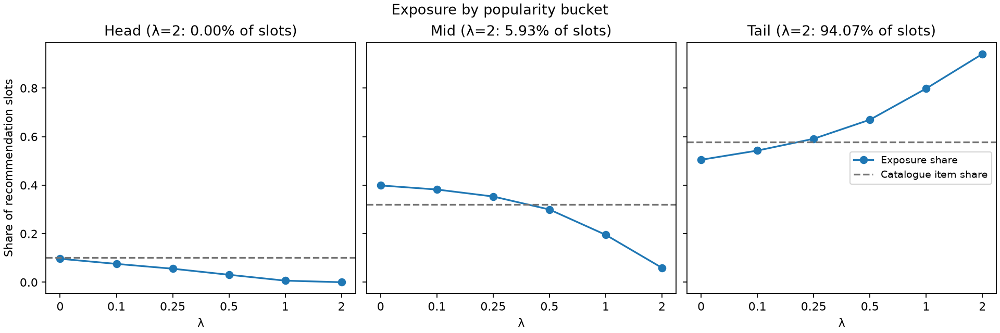
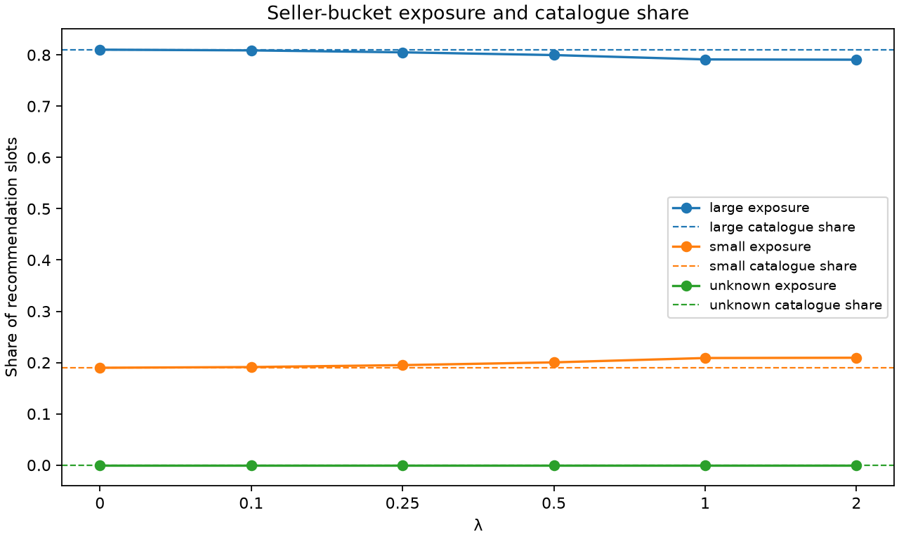
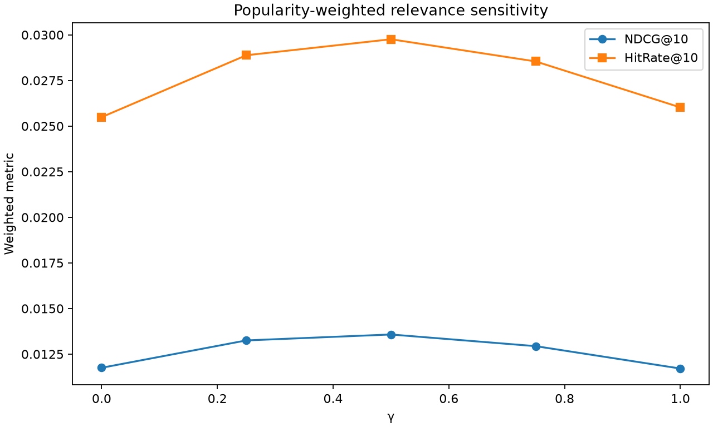

# Exposure Bias in Large Recommenders

**How much relevance does a popularity debias cost? — Amazon Reviews 2023, Electronics**

Vishanth (PES1UG24AM323) · Avinash Julakatti (PES1UG24AM347) · Rithesh (PES1UG24AM064)

Big Data Systems mini-project · November 2026 · Run: commit `c15fbb8`, generated 2026-11-02

---

## Abstract

We train an implicit-feedback ALS recommender on all 43.9 M Electronics reviews from Amazon
Reviews 2023 and measure who it shows. The 2.7 % of catalogue items that hold half of all training
interactions receive **99.96 %** of top-10 recommendation slots, a parity of **36.8×**. The 81 %
of the catalogue that is long tail receives **none**. Large storefronts take 98.6 % of slots
against a 79.7 % catalogue share. A post-hoc re-ranker that subtracts a z-scored popularity
penalty from the ALS score cuts the mean popularity of a recommended item by 36 % at λ = 0.5,
for 2.1 % of ALS's NDCG@10 edge over Random. At λ = 2 the cost rises to 35 %, and ALS falls below
MostPop. Even at λ = 2 the tail stays at zero exposure, because a re-ranker can only permute
the candidates it is given, and ALS's top-200 lists contain no tail items at all. We report this cost as an upper bound: the held-out labels are
themselves popularity-biased. A γ-weighted sensitivity check shows ALS's measured relevance comes
almost entirely from popular held-out items.

---

## 1. Introduction

A collaborative-filtering recommender learns from what users interacted with, and users can only
interact with what they were shown. Popular items therefore accumulate signal, are recommended
more, and accumulate more signal. At catalogue scale this feedback loop decides which products,
and which sellers, are visible at all. We ask two questions:

1. **How concentrated is exposure?** On a standard matrix-factorisation model trained on a real,
   large catalogue, what share of recommendation slots goes to popular items and large sellers,
   relative to their share of the catalogue?
2. **What does fixing it cost?** If a re-ranker moves exposure away from popular items, how much
   user relevance (NDCG@10, HitRate@10) is lost, expressed in units that mean something?

We chose Amazon Reviews 2023 because its item metadata carries a real `store` field. That lets us
*measure* seller size instead of proxying it, which matters for the second half of the question.

## 2. Related work and definitions

**Popularity bias.** Steck (2011) showed that accuracy metrics on observed data reward
recommending popular items, because popular items are over-represented among held-out positives.
Abdollahpouri et al. (2017, 2019) framed popularity bias as a long-tail coverage problem and
proposed regularisation and re-ranking remedies. Our re-ranker is of the post-hoc kind they
describe. **Fairness of exposure.** Singh & Joachims (2018) treat exposure as a resource allocated
across items or producers. We adopt their framing in our parity measure (exposure share ÷
catalogue share). **Debiased evaluation.** Schnabel et al. (2016) introduced inverse-propensity
weighting for recommendation evaluation. Our γ-weighted metric is a simple propensity-style
sensitivity check in that spirit. **Model.** We use the implicit-feedback ALS of Hu, Koren &
Volinsky (2008) via the `implicit` library. **Data.** Amazon Reviews 2023 (Hou et al., 2024).

**Definitions, fixed before any data was loaded** (frozen in `report/INTERFACE.md`):

| Concept | Operationalisation |
|---|---|
| Positive | `rating >= 4`. Lower ratings are *unobserved*, not negative, and are used only to exclude already-rated items from candidates. |
| Catalogue | Items with **≥ 3** train interactions. These are the only recommendable items. Items with fewer interactions are still trained on, but their factors are near-random and would inflate coverage with noise. |
| Popularity bucket | Interaction **mass**, not item percentile: `head` = items covering the first 50 % of catalogue train interactions, `mid` the next 30 %, `tail` the last 20 %. Item counts tie heavily at 1–3, so any percentile cut lands inside a tie block. |
| Seller size | `store_n_items` = catalogue items per store. `large` = stores covering the first 80 % of catalogue items, `small` the rest. A missing store is `unknown` and is reported on its own line, never folded into either bucket. |
| Exposure | Share of all top-10 slots a bucket receives. **Parity** = exposure share ÷ catalogue item share, where 1.0 is proportional. |
| Coverage / Gini | Fraction of catalogue items in at least one top-10 list; Gini over per-item exposure counts. |
| Relevance | NDCG@10 and HitRate@10 on the held-out item. Recall@10 is not reported: with one test item per user it equals HitRate@10 identically. |

## 3. Method

### 3.1 Data and split

`src/amazon_loader.py` streams the `raw_review_Electronics` and `raw_meta_Electronics` subsets
(local gzip JSONL or Hugging Face). It normalises `store` (missing / `None` / `"None"` / blank →
`""`) and `price` (unparseable → NaN, item kept), and rejects second-resolution timestamps.
`scripts/01_prepare.py` applies a **temporal leave-last-out** split per user. The last positive
goes to `test`, earlier positives to `train`, ties broken by timestamp then item id. **No user or
item is dropped at prepare time.** Filtering users keeps only the heaviest ones, and filtering
items deletes the very tail we claim to protect. Populations and the catalogue are downstream
views instead.

| Funnel stage | Users | Items | Rows |
|---|---:|---:|---:|
| Raw reviews | 18,286,191 | 1,609,860 | 43,886,944 |
| Positives (`rating >= 4`) | 14,795,065 | 1,404,832 | 33,387,473 |
| Non-positives (`seen` only) | 6,936,503 | 953,003 | 10,499,471 |
| Catalogue (≥ 3 train) | 5,935,606 | **538,448** | — |
| Exposure population (≥ 1 train positive) | 6,062,089 → 300,000 sampled | | |
| Relevance population (≥ 2 train positives) | 3,215,295 → 300,000 sampled | | |

The positive fraction is **0.761**, so the threshold separates a meaningful quarter of reviews.
The store null rate is only **0.59 %**, low enough for the seller claim to be made. **51.6 %** of
distinct test items fall outside the catalogue and are unreachable by construction. This caps
attainable HitRate for every model equally.

The bucket rules produce the expected long-tail shape and no degenerate store split:

| Popularity bucket | Items | Item share | Interaction share |
|---|---:|---:|---:|
| head | 14,607 | 2.71 % | 50.0 % |
| mid | 85,926 | 15.96 % | 30.0 % |
| tail | 437,915 | 81.33 % | 20.0 % |

| Store bucket | Stores | Store share | Catalogue item share |
|---|---:|---:|---:|
| large | 9,992 | 15.5 % | 79.7 % |
| small | 54,587 | 84.5 % | 19.9 % |
| unknown | — | — | 0.35 % |

The pre-registered degeneracy gate (`large` must hold ≥ 100 stores, `small` ≤ 95 % of stores)
passes, so the mass rule stands.

### 3.2 Model and candidates

`scripts/02_train.py` fits `implicit` ALS (64 factors, 15 iterations, regularisation 0.05,
confidence `1 + 40·r`, seed 42) on every train positive of catalogue items. For each sampled user
it scores the **full** catalogue and keeps the top 200, with already-rated items masked. No
negatives are sampled, so the metrics are not conditional on a sampled subset. The mean per-user
standard deviation of ALS scores is only **0.0036**. That is why the re-ranker must standardise
scores before adding a penalty.

### 3.3 Re-ranker

`scripts/04_rerank.py` re-scores each user's 200 candidates as

```
final = z(score) − λ · z(log1p(n_train_ratings)),     both z-scored within the user's list
```

and keeps the top 10. Z-scoring makes λ read as "standard deviations of relevance traded per
standard deviation of popularity". λ = 0 is an exact no-op, since z-scoring is monotone. The
re-ranker may only **permute** the candidate set, and this is asserted as a hard invariant, so any
change is attributable to the re-ranker alone. Grid: λ ∈ {0, 0.1, 0.25, 0.5, 1, 2}.

### 3.4 Evaluation and baselines

`scripts/03_evaluate.py` scores ALS, **MostPop** and **Random** through the same functions in
`src/metrics.py` (stdlib only, 52 hand-computed unit tests). Exposure is measured on the broad
population and relevance on the ≥ 2 population. Both populations carry exposure tables, so we can
check that the restriction does not change the picture. The relevance-cost claim is **gated**: it
is reported only because ALS beats MostPop on NDCG@10. Cost is expressed as
`ΔNDCG / (NDCG_ALS − NDCG_Random)`, the fraction of the model's whole edge over a trivial baseline
that the debias spends.

Two self-checks guard the harness. λ = 0 in the sweep and γ = 0 in the sensitivity file must each
reproduce `baseline_metrics.json` within 1e-6. Both hold, and `tests/test_integration.py` asserts
them on the real artefacts together with schema guards on every artefact boundary.

## 4. Results

### 4.1 The baseline over-exposes popular items and large sellers



| Model (relevance pop, n = 300,000) | NDCG@10 | HitRate@10 |
|---|---:|---:|
| ALS | **0.013341** | **0.022937** |
| MostPop | 0.008741 | 0.017463 |
| Random | 0.000011 | 0.000023 |

The gate passes: ALS beats MostPop by **53 %** relative NDCG@10, so the model has an edge to spend.
Absolute values are low. This is typical of full-ranking evaluation over a 538 k-item catalogue,
where half the test items are unreachable.

| ALS exposure (exposure pop, top-10) | head | mid | tail |
|---|---:|---:|---:|
| Exposure share | 99.955 % | 0.045 % | **0.000 %** |
| Catalogue item share | 2.71 % | 15.96 % | 81.33 % |
| Parity | **36.8×** | 0.003× | 0× |

Recommendations cover only **0.46 %** of the catalogue (≈ 2,450 items). Gini over item exposure is
**0.9992**, and the average recommended item has **11,351** train interactions. The relevance
population looks the same (head 99.97 %, coverage 0.41 %, Gini 0.9992), so the ≥ 2 restriction
does not drive the result. **Finding 1:** ALS concentrates essentially all exposure on the 2.7 % of
items that form the head, and the tail is invisible.

**Sellers.** Large stores take **98.6 %** of slots against a 79.7 % catalogue share (parity 1.24).
Small stores take **1.38 %** against 19.9 % (parity 0.07). In the store × popularity cross-tab,
≥ 99.9 % of slots fall in `head`, so the seller gap is measured almost entirely *inside* the head
bucket: head/large 98.58 %, head/small 1.38 %. A head-only parity needs the store composition of
head items. That lives in `items.parquet` rather than in the result JSONs, so we state the seller
effect as **observed but not yet separated from popularity** (§5).

### 4.2 The re-ranking trade-off



| λ | NDCG@10 | HitRate@10 | Cost (% of ALS–Random edge) | Mean rec. popularity | Mid share | Small-store share | Coverage |
|---:|---:|---:|---:|---:|---:|---:|---:|
| 0 | 0.013341 | 0.022937 | 0.0 % | 11,351 | 0.045 % | 1.38 % | 0.455 % |
| 0.1 | 0.013283 | 0.022780 | 0.4 % | 9,876 | 0.054 % | 1.68 % | 0.510 % |
| 0.25 | 0.013207 | 0.022597 | 1.0 % | 8,834 | 0.072 % | 1.82 % | 0.540 % |
| **0.5** | **0.013055** | **0.022180** | **2.1 %** | **7,207** | **0.109 %** | **2.13 %** | **0.604 %** |
| 1 | 0.012371 | 0.020590 | 7.3 % | 4,354 | 0.296 % | 2.90 % | 0.800 % |
| 2 | 0.008684 | 0.013907 | 34.9 % | 1,256 | 0.868 % | 4.81 % | 1.058 % |

*NDCG/HitRate/cost on the relevance population; exposure columns on the exposure population.*




The curve is convex. Small λ is almost free, and cost accelerates past λ = 1. As an
**illustrative operating point** (not a tuned choice; `chosen_lambda` is left `null` in the
artefact), **λ = 0.5** costs 2.1 % of ALS's edge over Random. In exchange it lowers the mean
popularity of a recommended item by **36 %**, raises catalogue coverage by **33 %**, and raises
small-store exposure from 1.38 % to 2.13 % (+55 % relative). At **λ = 2** the debias spends 35 % of
the edge, and NDCG (0.008684) drops just below MostPop (0.008741). That is a natural upper limit on
λ for this model.

**Finding 2 — the re-ranker cannot reach the tail.** Tail exposure is **exactly zero at every λ**,
including λ = 2, where the penalty outweighs two standard deviations of relevance. Exposure moves
from head to *mid* (0.045 % → 0.87 %), never to tail. A scan of `baseline_scores.parquet` on the
cloud run confirms why: all 116,984,800 top-200 candidate slots (584,924 users) contain **zero**
tail items, so there is nothing in the tail for the re-ranker to promote. A post-hoc re-ranker
inherits the bias of its
candidate generator. Moving exposure into the tail needs intervention at candidate generation
(popularity-aware sampling, a larger N, or regularisation in training), not only at ranking.

### 4.3 Sensitivity: how biased is the yardstick?



`scripts/05_sensitivity.py` re-weights each relevance-population user by `1 / pop(test item)^γ`,
with weights normalised to sum to 1, and recomputes the baseline ALS metrics. γ = 0 reproduces
the baseline exactly.

| γ | 0 | 0.25 | 0.5 | 0.75 | 1 |
|---|---:|---:|---:|---:|---:|
| NDCG@10 | 0.013341 | 0.004147 | 0.000997 | 0.000199 | 0.000036 |
| HitRate@10 | 0.022937 | 0.007389 | 0.001845 | 0.000382 | 0.000071 |

Up-weighting users whose held-out item is less popular collapses ALS's measured quality: −69 % at
γ = 0.25 and −99.7 % at γ = 1. Almost all of ALS's observed NDCG is earned on popular held-out
items. The observed-interaction metric therefore rewards popularity by construction, and a
re-ranker that moves away from popular items is penalised by the yardstick as well as by any real
loss in relevance.

## 5. Loss in relevance, limitations, and conclusion

**What the cost means.** On observed interactions, a meaningful popularity debias (λ ≤ 0.5)
costs ≤ 2.1 % of ALS's edge over Random. A strong one (λ = 2) costs 35 % and erases the advantage
over MostPop. **These are upper bounds.** Test labels come from a system that already
over-exposed popular items, so tail items are under-observed. The sensitivity analysis confirms
that ALS's measured relevance sits almost entirely on popular test items. The true cost to users
is likely smaller. We cannot say how much smaller without a debiased cost *per λ*: §4.3 weights the
baseline only. Re-running `05_sensitivity.py` on each `rerank_scores_lambda_*.parquet` is the
direct next step.

**Limitations.**

- **Temporal split is per user, not global.** Other users' later interactions remain in training,
  a mild leak shared by all models.
- **51.6 % of distinct test items are outside the catalogue**, so HitRate is capped well below 1
  for every model. Comparisons between models remain valid.
- **`store` is a storefront/brand label, not a verified seller id.** "Large seller" means a label
  attached to many catalogue items. Bulk listing is part of that by design.
- **The seller effect is not yet separated from popularity.** Nearly all exposure is in `head`,
  and the head-only store parity needs `items.parquet`.
- **Sampled populations** (300 k users each, fixed seed 42) and a single training seed. Per-user
  arrays are saved in `results/per_user_metrics.parquet`, so a paired bootstrap on the cost delta
  is a short addition. We did not run it.
- **Funnel quirk:** the `catalogue_ge_3` stage records the item count in its `interactions` field.
  It is a labelling issue only, and no metric reads it.
- One category (Electronics), one model family (ALS), and one re-ranking rule.

**Conclusion.** A standard ALS recommender on a 538 k-item real catalogue gives 2.7 % of items
99.96 % of the exposure, shows the long tail to nobody, and favours large storefronts. A z-scored
popularity penalty buys a real reduction in recommended popularity and a gain in small-seller
exposure cheaply at moderate λ. It does not reach the tail, because the candidate set never
contained it, and the measured cost is inflated by popularity-biased evaluation. Fixing exposure
bias at scale therefore needs changes upstream of the ranker, and judging the fix needs an
evaluation protocol that is not itself biased toward popularity.

---

### Reproducibility

```bash
python scripts/01_prepare.py      # ratings/items parquet + prepare_funnel.json
python scripts/02_train.py        # ALS + baseline_scores.parquet + run_manifest.json
python scripts/03_evaluate.py     # baseline_metrics.json (ALS, MostPop, Random)
python scripts/04_rerank.py       # rerank_sweep.json + per-λ parquet + per_user_metrics
python scripts/05_sensitivity.py  # sensitivity.json
python scripts/06_report.py       # tables + figures/*.png, reads results/* only
python -m pytest                  # unit + integration suite
```

### References

- Abdollahpouri, H., Burke, R., Mobasher, B. (2017). Controlling popularity bias in
  learning-to-rank recommendation. *RecSys*.
- Abdollahpouri, H., Burke, R., Mobasher, B. (2019). Managing popularity bias in recommender
  systems with personalized re-ranking. *FLAIRS*.
- Hou, Y., Li, J., He, Z., Yan, A., Chen, X., McAuley, J. (2024). Bridging language and items for
  retrieval and recommendation. *arXiv:2403.03952*.
- Hu, Y., Koren, Y., Volinsky, C. (2008). Collaborative filtering for implicit feedback datasets.
  *ICDM*.
- Schnabel, T., Swaminathan, A., Singh, A., Chandak, N., Joachims, T. (2016). Recommendations as
  treatments: debiasing learning and evaluation. *ICML*.
- Singh, A., Joachims, T. (2018). Fairness of exposure in rankings. *KDD*.
- Steck, H. (2011). Item popularity and recommendation accuracy. *RecSys*.
